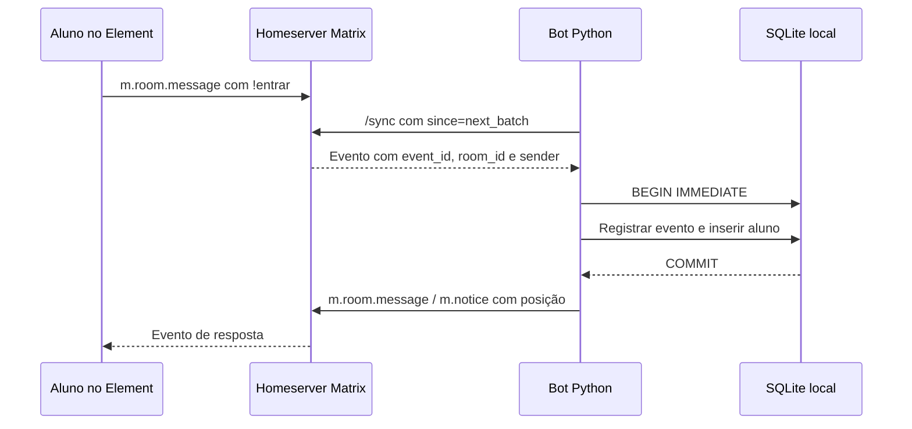

# Arquitetura da Fila Acadêmica

## Participantes e comunicação assíncrona

Alunos e professores usam Element em processos/dispositivos independentes. O
cliente envia eventos ao homeserver Matrix existente, que os disponibiliza ao
bot pela API de sincronização. O bot responde por um novo evento na sala. Salas
podem envolver servidores federados, mas esta aplicação também funciona quando
todos usam um único homeserver.



`AsyncClient.sync()` usa long polling: o servidor pode manter a requisição aberta
até haver eventos ou o timeout vencer. `asyncio` permite aguardar rede sem bloquear
o loop. O callback aguarda `asyncio.to_thread()` para executar o comando SQLite
fora desse loop; a conexão é criada e fechada na própria thread. Não se compartilha
uma conexão SQLite entre threads, nem se mantém uma transação aberta durante envio
de mensagens pela rede. O SDK aguarda callbacks na ordem recebida e há um único
processo escritor, conforme a premissa do projeto.

## Camadas

| Módulo | Responsabilidade |
| --- | --- |
| `config.py` | Ler `.env`/ambiente, validar URLs, IDs e campos obrigatórios. |
| `database.py` | Criar tabelas e índices; abrir, confirmar, reverter e fechar transações. |
| `queue_service.py` | Consultar e alterar a fila usando uma conexão transacional recebida. |
| `command_handler.py` | Deduplicar eventos, interpretar comandos e conferir professores. |
| `matrix_client.py` | Sincronizar, filtrar eventos, executar o handler em thread e responder. |
| `main.py` | Montar os componentes e encerrar os recursos. |

`QueueService` não importa `nio`. Seus métodos devem ser usados dentro de
`Database.transaction()`. Isso permite que a alteração de estado e o registro do
evento compartilhem a mesma transação sem uma camada adicional de abstração:

```python
with database.transaction() as connection:
    service = QueueService(connection)
    service.join(room_id, user_id)
```

Na aplicação, o handler insere o `event_id` antes de chamar o serviço e formata a
resposta antes do commit. Permissões são baseadas no `sender` real, comparado com
`PROFESSOR_IDS`, e a fila usa o `room_id` real. Não se confia no nome exibido pelo
Element, nem em um usuário mencionado no corpo do comando.

## Sincronização e eventos antigos

Na inicialização, o cliente ainda não tem cursor e nenhum callback foi registrado.
Uma primeira chamada bem-sucedida a `sync()` popula as salas e `client.next_batch`,
mas não executa as mensagens recebidas. Só então se instala o callback para
`RoomMessageText`. As próximas chamadas usam automaticamente esse `next_batch`
como `since`, conforme o SDK instalado. Não se compara o relógio dos eventos ao
relógio local para decidir se são históricos.

Uma falha de conexão mantém o mesmo objeto cliente e seu cursor; a reconexão não
repete o procedimento inicial. Há espera exponencial de 1 até 30 segundos. Token
inválido ou acesso proibido encerra a execução para correção manual. O programa
fecha a sessão HTTP em `finally`, inclusive em cancelamento por `Ctrl+C`.

O cursor não é persistido: a cada reinicialização o lote inicial é novamente
ignorado. Assim, não há garantia de execução dos comandos enviados enquanto o bot
estava desligado. Uma timeline marcada como limitada também pode ter lacunas que
esta implementação não busca no histórico. As tabelas locais, por outro lado,
preservam os comandos já confirmados. Uma futura retomada durável precisaria
persistir o cursor de forma coordenada com o processamento do lote.

O callback descarta salas fora da lista, salas criptografadas, eventos enviados
pelo bot, textos sem `!` e eventos de edição. Outros tipos de evento não são
registrados no callback. O bot não aceita convites automaticamente. Antes do log
de prontidão, confere se já participa das salas configuradas e se não usam E2EE.

## FIFO e persistência

- `fila_espera`: `id INTEGER PRIMARY KEY AUTOINCREMENT`, sala, usuário e instante
  UTC de criação. `UNIQUE(room_id, user_id)` impede duplicidade na espera. O índice
  `(room_id, id)` atende à consulta FIFO com `ORDER BY id`.
- `atendimentos`: sala, usuário, início, término e status. Um índice único parcial
  sobre `room_id WHERE status = 'ativo'` impede dois atendimentos ativos na sala.
  Constraints exigem término preenchido apenas no status finalizado. Finalizar é
  um `UPDATE`; o histórico permanece no banco.
- `eventos_processados`: `event_id` como chave primária, sala e instante UTC de
  processamento. Eventos Matrix têm identificadores próprios, diferentes dos IDs
  de usuários ou nomes das salas.

O instante registrado serve para histórico, não para ordenar a fila. IDs de
inserção resolvem inclusive empates de timestamp. FIFO é local à ordem na qual o
bot confirma as entradas, e não uma ordem global entre todos os dispositivos.

`BEGIN IMMEDIATE` adquire a reserva de escrita antes das verificações. O serviço
verifica se o aluno já espera ou está em atendimento antes de inserir. Ao chamar
o próximo, verifica atendimento ativo, lê o menor ID, remove a espera e insere
o atendimento na mesma transação. Ao falhar, o rollback recupera a espera.
O índice parcial é uma defesa adicional para atendimento único. A exclusão entre
espera e atendimento do mesmo aluno é garantida pelas regras do serviço na
transação; alterações manuais diretas no banco devem ser evitadas.

Posições são contagens na fila atual, não o ID da linha; remover alguém da espera
faz as posições seguintes avançarem. Todas as consultas filtram a sala. O mesmo
usuário pode esperar ou ser atendido simultaneamente em salas diferentes.

## Idempotência, falhas e consistência

Para cada comando, o handler tenta inserir seu `event_id` com
`ON CONFLICT(event_id) DO NOTHING`. Se já existe, não altera o estado nem envia
outra resposta. Se é novo, interpreta o comando dentro da mesma transação.
Recusas de negócio e de permissão também são registradas, pois reavaliá-las depois
poderia executar um comando anteriormente recusado em outro estado da fila.
Erros inesperados do banco propagam e revertem a transação completa.

| Momento da falha | Efeito |
| --- | --- |
| Antes do commit SQLite | Evento e alterações são revertidos; o mesmo evento pode ser reaplicado se for recebido de novo. |
| Depois do commit, antes de confirmar o envio | A fila já mudou; a resposta pode estar ausente ou ter chegado sem confirmação. |
| Evento confirmado recebido novamente | A chave primária impede outra execução. |
| Reinicialização | Estado confirmado continua no SQLite; o novo lote inicial Matrix é descartado. |
| Falha do disco ou perda do arquivo | Sem réplica/backup automático, pode ocorrer perda do estado local. |

SQLite e envio Matrix não participam de uma transação distribuída. Há atomicidade
local do evento processado com a fila, mas não atomicidade entre o banco e a
resposta publicada. A deduplicação oferece no máximo uma aplicação de um evento
confirmado, condicionada à preservação do banco. Não oferece execução de todos
os eventos nem entrega exatamente uma vez das respostas.

Uma melhoria futura seria uma **outbox transacional**: salvar a resposta pendente
junto com o comando, enviá-la em uma tarefa separada com identificador de transação
Matrix estável e marcar a confirmação. Isso reduziria a perda de respostas após
falhas. Não está implementado nesta base.

A comunicação com Matrix é assíncrona e pode atrasar ou falhar. A sala contém
mensagens de interação; o estado da fila fica no SQLite do bot. A possível
federação do Matrix não replica esse banco nem estabelece consenso para a fila.
Não há eleição de líder, coordenação entre bots ou tolerância a múltiplos escritores.
Use uma única instância e mantenha o banco em disco local fora de sincronizadores
de arquivos ou volumes de rede. Retenção de histórico e backups ficam a cargo do
operador nesta versão acadêmica.

## Verificação

Os testes usam SQLite temporário e não precisam de rede. Além das regras, forçam
falhas com triggers SQLite para verificar rollback e a atomicidade de evento com
estado. O teste de sincronização fornece respostas fictícias ao transporte, mas
usa `SyncResponse.from_dict()`, `receive_response()` e a construção de `/sync`
do SDK real para verificar o descarte inicial e a continuidade do cursor. Isso
não substitui uma demonstração com credenciais e homeserver reais.

Referências: [matrix-nio](https://matrix-nio.readthedocs.io/en/latest/nio.html),
[sincronização Matrix](https://spec.matrix.org/latest/client-server-api/#syncing)
e [transações SQLite](https://www.sqlite.org/lang_transaction.html).
